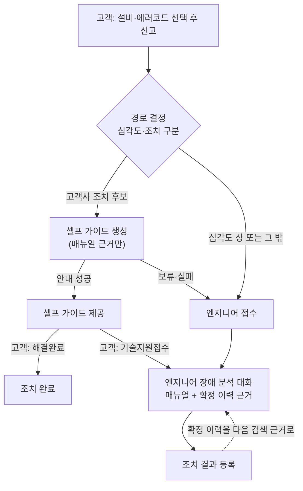

<p align="center">
  
</p>

# M-Pilot · 설비 장애 대응 지원 서비스

> 현대 AI Insight Campus 1차 팀 프로젝트(7인, 2026.10.21 ~ 11.02)를 개인 저장소로 포크했습니다.
> 원본 저장소: [movebrain/m-pilot](https://github.com/movebrain/m-pilot) · 팀 전체 소개는 [docs/TEAM_README.md](docs/TEAM_README.md)
>
> 이 README는 **제가 맡은 부분(팀장·PM, UI·서비스 계층)** 위주로 정리했습니다.
> 매뉴얼·에러코드·서비스 이력은 모두 팀이 만든 **가상 데이터**입니다.

<p align="center">
  
  
  
  
</p>

## 한눈에 보기

| 항목 | 내용 |
|---|---|
| 서비스 | 현대무벡스 물류 설비 4종(SRM·RTV·AGV·Mini Loader)의 에러코드 신고를 받아, 고객이 직접 조치할 수 있는 고장은 매뉴얼 근거로 **셀프 가이드**를 주고, 그 밖의 고장은 **엔지니어에게 접수**해 근거·출처가 붙은 답을 주는 RAG 서비스 |
| 내 역할 | **팀장·PM** (기획·명세·업무분장·변경 관리), **UI·서비스 계층 단독 담당** |
| 담당 코드 | `app.py` `app_customer.py` `app_engineer.py` `mpilot/ui/` `mpilot/service.py` `fake/` |
| 담당 화면 | 고객 앱 3개(신고 목록·작성·상세), 엔지니어 앱 3개(대시보드·장애 분석 대화·조치 결과 저장) |
| 기여 규모 | TODO: 머지한 PR 수 / 작성한 테스트 수 / 커밋 수 |

## 문제 정의

설비가 멈추면 현장은 "무엇부터 해야 하지?"에서 시간을 씁니다. 매뉴얼은 수백 쪽이고, 같은 에러라도 고객이 직접 조치해도 되는지, 엔지니어가 가야 하는지에 따라 대응이 완전히 달라집니다. 잘못된 안내는 설비 고장이나 안전사고로 이어질 수 있습니다.

그래서 M-Pilot은 **근거가 있을 때만 답한다**는 원칙으로 만들었습니다. 경로는 LLM이 아니라 에러코드 표의 심각도와 조치 구분으로 정하고, 모든 답변은 매뉴얼의 쪽·절이나 확정된 조치 이력에 연결되며, 근거를 찾지 못하면 지어내지 않고 그 사실만 알립니다.



## 내가 한 일

### 1. PM: 7명이 서로 기다리지 않고 동시에 개발하는 구조

**문제.** 초기 업무분장은 한 이슈를 두세 명이 겹쳐 맡거나, 이슈 번호가 명세와 충돌하거나, 아예 이슈가 없는 기능이 있었습니다. 이대로면 누가 무엇을 끝내야 하는지 불분명하고, 앞 파트가 끝나야 뒤 파트가 시작하는 순서 의존이 생깁니다.

**한 일.**
- 업무분장을 세 가지 원칙으로 다시 세웠습니다. 파트별로 **소유하는 코드 파일이 겹치지 않게**, **기능(US) 하나에 담당 파트 하나**, 다른 파트 결과물은 **가짜 구현으로 대신하고 나중에 교체**합니다. 그 결과 팀을 UI(1인)·RAG(3인)·DB(3인)로 나누고 파트별 폴더를 명확히 했습니다.
- 문서를 세 층으로 운영했습니다. `intent.md`(기획 의도) → `spec.md`(기능·아키텍처 명세, 함수 계약) → `ADR.md`(변경 기록). 개발 중 바뀌는 결정은 매번 모든 문서를 고치지 않고 ADR에 쌓아 팀원이 최신 결정을 한 곳에서 확인하도록 했습니다.
- 함수 시그니처나 공통 모델을 바꾸면 **같은 PR에서 spec도 고치고 `계약 변경` 라벨**을 붙이는 규칙을 만들었습니다. 파트가 나뉜 팀에서 인터페이스가 몰래 바뀌는 일을 막기 위해서입니다.
- 브랜치 전략(`main` ← `develop` ← 작업 브랜치), conventional commit, PR 본문 형식을 정하고, AI 코딩 도구도 같은 규칙을 따르도록 저장소에 `CLAUDE.md`와 `.claude/skills/`(브랜치·커밋·PR 작성 규칙)를 두었습니다.
- 산출물: 기획안, 기능명세서·WBS, Figma 화면 와이어프레임, ADR

**주요 변경 결정 (ADR)**

| 번호 | 결정 | 이유 |
|---|---|---|
| CHG-01 | 로그인 제거, 고객·엔지니어 앱을 따로 실행 | 8일 안에 인증·권한까지 만들면 핵심 기능(근거 기반 답변)이 밀림. 역할 분리는 데모용으로 명시 |
| CHG-02 | 신고 시 사진 첨부 제거 | 사진 판독은 근거 기반 답변과 직접 관련이 없고 범위만 키움. 후속 개선으로 이동 |
| CHG-03 | 셀프 가이드에 고객 확인 단계 추가 | 아래 5번 참고 |

### 2. UI: 역할별로 분리된 두 개의 Gradio 앱

| 앱 | 화면 | 내용 |
|---|---|---|
| 고객 (7860) | 신고 작성 | 설비와 에러코드를 고르고 제출하면 접수번호 발급 |
| | 신고 목록 | 내 신고를 최신순·상태별로 조회 |
| | 신고 상세 | 셀프 가이드 건은 단계별 안내와 출처, 엔지니어 처리 건은 완료 뒤 조치 결과. 내부 분석은 보이지 않음 |
| 엔지니어 (7861) | 대시보드 | 기존 이력과 신규 신고를 상태별로 보고, 기술지원 건을 누르면 대화창으로 이동 |
| | 장애 분석 대화 | 신고한 에러코드를 기준으로 같은 설비의 매뉴얼·과거 이력에서 찾은 근거로 출처가 붙은 답 |
| | 조치 결과 저장 | 원인·실제 조치·결과를 입력해 완료. 확정된 조치는 다음 질문의 근거가 됨 |

모든 화면에 "모든 데이터는 가상"을 표시하고, 오류는 내부 메시지 대신 고정 문구로만 안내합니다.

<!-- TODO: 화면 캡처 넣기 (images/screens/*.png) -->
| 고객 신고 상세 (셀프 가이드) | 엔지니어 장애 분석 대화 |
|:---:|:---:|
| TODO: 캡처 | TODO: 캡처 |

### 3. 서비스 계층(`service.py`): 화면과 DB·RAG 사이의 규칙

화면은 `service` 함수만 부르고, `service`가 DB 저장과 RAG 호출을 조립합니다. RAG는 저장을 하지 않고, 저장은 `service`만 맡도록 **의존 방향을 한쪽으로** 고정했습니다.

```text
app*.py → ui/* → service → db/* · rag/pipeline → rag/retriever · rag/generator → models
                 └ 내 담당
```

가장 신경 쓴 부분은 **일부가 실패했을 때 무엇을 남기고 무엇을 버릴지**입니다.

| 상황 | 처리 | 이유 |
|---|---|---|
| 셀프 가이드 생성이 보류되거나 실패 | 엔지니어 접수로 넘김 | 고객은 실패를 볼 필요 없이 접수만 되면 됨 |
| 허용 절차가 없는 고객사 조치 코드 | AI를 부르지 않고 바로 보류 | 매뉴얼 근거 없는 안내를 원천 차단 |
| 엔지니어 질문 실패(장애·인용 검증 실패·시간 초과) | 대화를 저장하지 않고 오류로 알림 | 검증되지 않은 답을 기록으로 남기지 않음 |
| 조치 확정 중 검색 반영 실패 | DB 저장은 유지하고 실패만 알림, 앱 재시작 때 색인 재생성 | 확정 기록이 정본이고 검색 색인은 다시 만들 수 있음 |

### 4. 가짜 모드: DB·RAG 완성 전에 화면부터 완성

UI는 DB·RAG가 끝나야 실제로 돌릴 수 있어서, 그대로 두면 일정 마지막에 몰립니다. 그래서 두 가지 실행 방식을 만들었습니다.

| 명령 | 동작 | 용도 |
|---|---|---|
| `python app_customer.py --fake` | `fake_service.install()`로 service 함수를 통째로 바꿔 끼움. 원자료 CSV와 메모리만 사용 | DB·키 없이 화면 흐름 확인 |
| `python -m fake.run --both` | 가짜 DB(메모리) 위에서 **진짜 service·RAG** 실행 | MySQL 없이 실제 답변까지 확인 |

`service.py`에는 진짜 호출만 두고 가짜는 `fake/`에만 두어, 시연용 코드가 실제 코드에 섞이지 않게 했습니다.

### 5. 셀프 가이드 고객 확인 단계 (CHG-03)

**문제.** 처음에는 셀프 가이드 건이 접수되는 순간 '조치 완료'로 저장됐습니다. 안내를 줬을 뿐 실제로 해결됐는지는 모르는데도 완료로 보였고, 안내대로 해도 안 되면 고객은 새 신고를 다시 해야 했습니다.

**결정.** 해결 여부는 고객만 확인할 수 있으므로, 셀프 가이드 건은 고객이 확인해야 완료되도록 바꿨습니다.

| 고객 동작 | 결과 |
|---|---|
| [해결완료] | 조치 완료. 고객 확인만으로 완료된 건은 검색 근거(확정 이력)에 넣지 않음 |
| [기술지원접수] | **같은 접수번호**를 엔지니어 처리 건으로 전환해 대화로 이어짐 |

엔지니어는 고객 확인 전 셀프 가이드 건을 읽기만 할 수 있고, 질문이나 조치 결과를 저장할 수 없습니다. 이슈 → ADR·spec 수정 PR → 구현 PR 순서로 진행해, 영향받는 DB 담당과 계약을 먼저 맞춘 뒤 코드를 바꿨습니다.

## 트러블슈팅

### 접수는 성공으로 보이는데 DB에는 저장되지 않음
- **발견.** 통합 전 `develop` 브랜치의 DB 코드를 검토하다가, 신고 저장 함수가 아직 빈 함수(stub)인데 `service`가 반환값을 확인하지 않아 화면에는 접수 성공이 뜨고 상세 조회에서야 실패하는 것을 찾았습니다.
- **원인.** 가짜 모드에서는 가짜 저장소가 메모리에 실제로 저장하기 때문에 이 문제가 드러나지 않았습니다. 구현은 아직 머지되지 않은 브랜치에 있었습니다.
- **조치.** TODO: 실제로 한 조치 (예: 저장 브랜치 머지 요청, service 반환값 검증 추가, 테스트 추가)
- **배운 점.** 가짜 구현은 병렬 개발을 가능하게 하지만 **통합 버그를 가린다**. 가짜와 진짜가 같은 계약을 지키는지 확인하는 통합 점검이 따로 필요하다.

### 병렬 PR끼리 같은 줄 충돌
- 화면별로 독립 PR을 올렸더니, 두 PR이 `service.py`의 같은 import 줄에 서로 다른 예외 클래스를 추가해 충돌했습니다. 늦게 머지되는 쪽에서 `develop`을 병합해 둘 다 남기는 방식으로 정리하고, 충돌 지점을 PR에 미리 적어 리뷰어가 알 수 있게 했습니다.

## 실행

가장 간단한 방법은 아무것도 설치하지 않은 화면 확인입니다.

```bash
python3.12 -m venv venv && source venv/bin/activate   # Windows: py -3.12 -m venv venv, venv\Scripts\activate
python -m pip install -r requirements.txt
python app_customer.py --fake     # 고객 앱     http://127.0.0.1:7860
python app_engineer.py --fake     # 엔지니어 앱 http://127.0.0.1:7861
```

MySQL과 OpenAI 키를 쓰는 실제 실행, 데이터 적재, 문제 해결은 [docs/RUN.md](docs/RUN.md)를 참고하세요.

| 눌러 볼 설비 / 코드 | 기대 경로 |
|---|---|
| AGV A302, RTV R207 | 셀프 가이드 |
| Mini Loader M402 | 심각도 상 → 엔지니어 접수 |
| SRM S102 | 엔지니어 필요 → 엔지니어 접수 |

테스트는 `python -m pytest`로 실행합니다.

## 팀과 크레딧

팀 프로젝트이며, 아래 파트는 다른 팀원의 작업입니다.

| 이름 | 파트 | 맡은 일 |
|---|---|---|
| **노동균** | **PM·UI** | 기획·명세·업무분장, 고객·엔지니어 화면, 서비스 계층, 가짜 모드 |
| 김성일 · 손재호 · 이재서 | DB | 매뉴얼 PDF 파싱·청킹, 초기 자료 적재, 신고·대화·조치 저장, 검색 색인 |
| 한시온 · 도예진 · 정혜윤 | RAG | 근거 검색, 답변 생성·인용 검증, 고객 안내·엔지니어 답변 흐름, 품질 평가 |

## 회고

### Keep
- **이슈 정리로 R&R을 정확히 나눈 것.** 기능 하나에 담당 파트 하나, 파트별 파일 소유를 겹치지 않게 나눠 누가 무엇을 끝내야 하는지 분명했습니다.
- **기획안과 명세를 .md 파일로 확정해 둔 것.** 팀 회고에서 팀원 4명이 intent·spec 문서 체계와 그 위에서 합의한 규칙(브랜치 전략, 모든 PR 1명 이상 승인)을 잘한 점으로 꼽았습니다.

### Problem
- **계층별로 나눠서 통합이 늦었습니다.** UI·DB·RAG로 나누다 보니 다 합치고 나서야 전체 동작을 확인할 수 있었고, 검색 품질 문제도 병합 뒤에야 발견했습니다.
- **명세가 자세한 만큼 변경 비용이 컸습니다.** AI가 코드를 만드는 속도를 사람의 리뷰가 따라가지 못해, 구현 상황을 파악하는 데 시간이 걸렸습니다.
- **산출물 관리가 마감에 몰렸습니다.** 마감 당일에 릴리스와 WBS를 한꺼번에 갱신해 산출물 사이 버전이 어긋났고, 보고서의 기능 목록이 실제 구현과 다르다는 평가를 받았습니다.

### Try
- **가짜(Mock) 데이터를 실제와 더 가깝게 만들기.** 가짜 저장소가 저장 버그를 가렸던 경험(트러블슈팅 참고)처럼, 가짜가 정교해야 만든 기능을 제대로 테스트할 수 있습니다.
- **개발 전에 평가 문항부터 만들기.** 중간 머지마다 같은 문항으로 정량 비교합니다.
- **분담 단위 바꾸기.** 계층이 아니라 기능(신고·접수·채팅·이력) 단위로 나누는 것을 검토합니다.
- **문서는 PR마다 갱신하기.** 마감 때 몰아서 갱신하지 않습니다.

비전공자 팀원들과 AI 코딩 도구를 함께 쓰며 개발했고, 커밋하는 사람이 설명할 수 있는 코드만 반영한다는 규칙을 지켰습니다.
